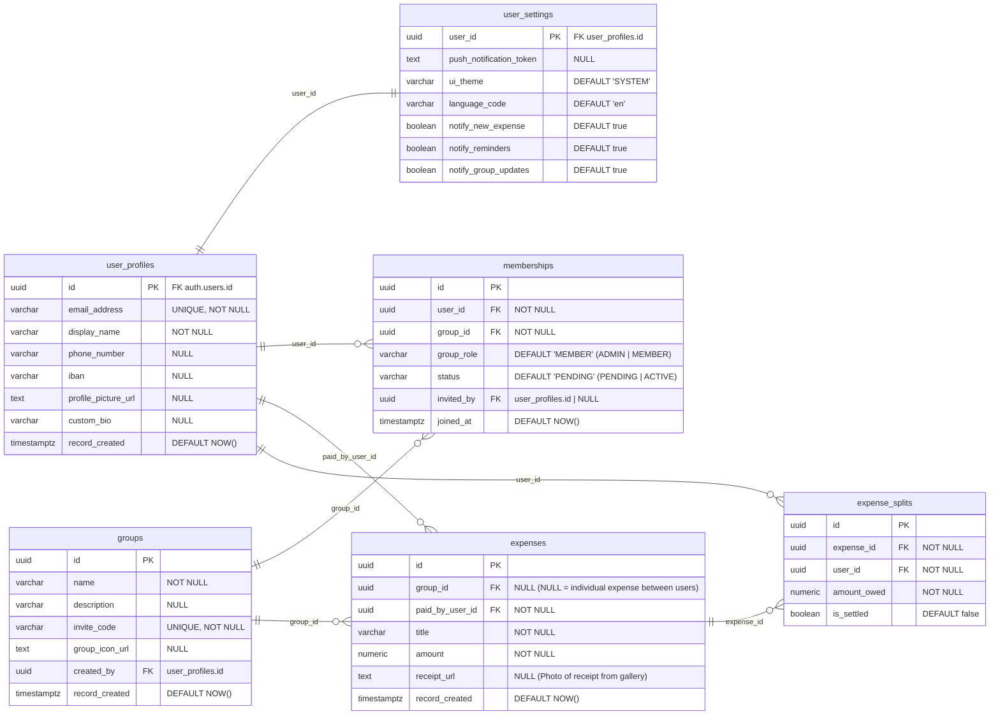

# Lumin

Lumin is a mobile-first app for organizing groups and shared expenses. It is
built with Expo, React Native, and Supabase as part of the Mobile Applications
course.

## Target Audience

Lumin is for people who organize activities together and want to keep track of
shared costs:

- Friends planning trips, get-togethers, or dinners;
- Roommates and families managing shared expenses;
- Student groups and other small communities;
- Small teams tracking informal group expenses.

The app is particularly aimed at groups that need to split costs, while also
keeping track of expenses between two individuals. Over time, the modular
concept could be expanded with additional group-organization features.

## What We Are Building

The focus of this project is an easy-to-use expense tracker for groups and
individuals. Users can manage groups, record expenses, split amounts between
participants, and keep track of outstanding balances. The app structure is
designed to allow additional group-organization modules to be added later.

### Current Status

- The app includes screens for login, a home feed, groups, profile, and settings.
- Supabase is used for authentication and data storage.
- The services support group management, memberships, and invitations.
- Expense services support creating, editing, and deleting expenses, managing
  expense splits, and updating payment statuses.
- Some screens are still prototypes: certain actions, including group creation
  from the groups screen and notification preferences, are not fully connected
  yet.

## Roadmap

- [x] Set up the base app and navigation with Expo Router.
- [x] Add Supabase authentication and services for groups and expenses.
- [ ] Fully connect the group and expense flows to the app screens.
- [ ] Clearly present balances and repayments, including expenses between
      individual users.
- [ ] Allow users to attach receipt photos to expenses.
- [ ] Implement push notifications for new expenses, group updates, and payment
      reminders.
- [ ] Evaluate the modular concept and expand it with additional
      group-organization features.

This roadmap is a guide and may change as the project develops.

## Competitors

- **Splitwise** helps people and groups track and split shared expenses.
- **Tricount** focuses on splitting group costs, for example during trips or
  shared activities.

Lumin addresses the same need, but aims to combine expense tracking with a
broader, modular environment for group organization. The initial project focus
remains a clear expense tracker for both groups and expenses between individuals.

## Technology

- [Expo](https://expo.dev/) and [React Native](https://reactnative.dev/) for the
  mobile app and web/PWA support.
- [Expo Router](https://docs.expo.dev/router/introduction/) for navigation.
- [Supabase](https://supabase.com/) for authentication and the backend.
- TypeScript for the application code.

## Data Model

The diagram below shows the intended core model for profiles, groups, and
expenses. An expense with an empty `group_id` can be used for expenses between
individual users.



## Run Locally

### Requirements

- Node.js and npm
- A Supabase project with the required database

### Installation

1. Install the dependencies:

   ```sh
   npm install
   ```

2. Create a `.env.local` file in the project root with your Supabase credentials:

   ```env
   EXPO_PUBLIC_SUPABASE_URL=https://dqkcnsuvezhabajkdqxs.supabase.co
   EXPO_PUBLIC_SUPABASE_KEY=sb_publishable_w9JdZy8cSa3zjoOlDWT8LA_SMHH1rWp
   ```

3. Start Expo:

   ```sh
   npm start
   ```

   To run the web version:

   ```sh
   npm run web
   ```

## Testing

The end-to-end tests are written with Cypress. Start the app first, then run:

```sh
npm run cypress:run
```
